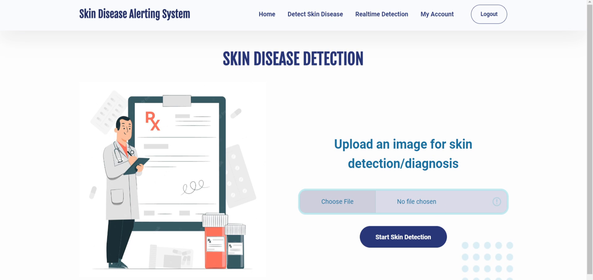
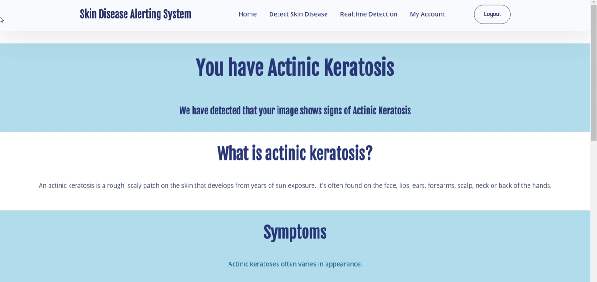
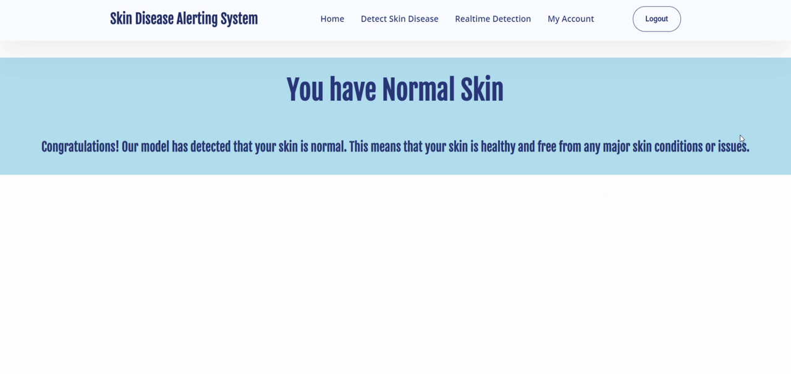
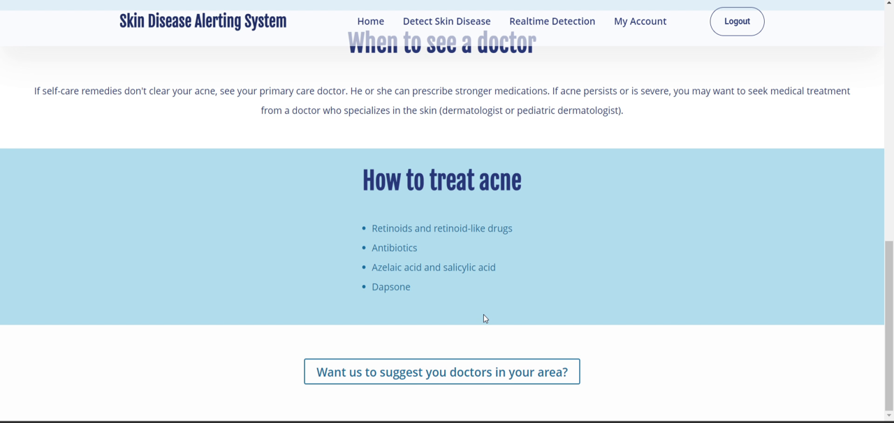

# Automated Skin Disease Alerting System

A Flask web application that classifies skin-condition images with deep-learning models and shows information about the predicted condition (symptoms, causes, treatment). Final-year team project, B.E. Electronics & Telecommunication, Thakur College of Engineering and Technology (TCET), University of Mumbai.

**Publication:** first author, *Automated Skin Diseases Alerting System Using Machine Learning Approach*, MULTICON-W 2023 (AICTE-sponsored international conference), IC-CCDS-2023 Proceedings, p. 176.

> **Disclaimer:** educational and research project. It is not a medical device and not a substitute for professional diagnosis.

## Screenshots

| Upload page | Result page |
|---|---|
|  |  |
|  |  |

## Features

- User registration, login and account page (Flask-Login, bcrypt-hashed passwords, SQLite)
- **Image upload detection:** the uploaded image is classified and the matching condition page is shown
- **Real-time detection:** webcam classification in the browser with ml5.js, showing the predicted condition and a confidence percentage
- Information pages for each condition (symptoms, causes, treatment)
- Password reset by email (needs your own SMTP credentials)

## How it works

| Part | Files | What it does |
|---|---|---|
| Web app (port 5051) | `run.py`, `sdp/` | Pages, accounts, uploads, disease information |
| Classification service (port 5052) | `app.py` | Loads the Keras model `sdp/gnew_model.h5` (224x224 input, 14 labels in `sdp/gnew_labels.txt`) and returns the predicted class for an uploaded image |
| Real-time page | `sdp/static/js/` | Browser model exported from Google Teachable Machine, run with ml5.js (labels in `sdp/static/js/metadata.json`) |
| Training notebook | `sdp/mlmodel.ipynb` | Keras CNN (AlexNet-style): 227x227 input, augmentation (shear, zoom, shifts), SGD (lr 0.01, momentum 0.9, decay 5e-4), categorical cross-entropy, batch size 16, 50 epochs. The saved notebook output shows 3,192 training and 414 validation images across 23 class folders |

## Dataset and results

- The paper describes 4,002 images covering 22 skin conditions. The raw dataset is **not** included in this repository; please download it from its original source and respect its licence.
- The paper reports **80% accuracy** in the testing phase.
- The demo models bundled here are smaller exports (14 classes for image upload, 9 for real-time detection), so they cover fewer conditions than the 22-condition experiment described in the paper.

## Run it locally

Requires **Python 3.8 or 3.9** (TensorFlow 2.5).

```bash
git clone https://github.com/HetDani/skin-disease-classification-cnn.git
cd skin-disease-classification-cnn
python -m venv venv
venv\Scripts\activate          # Windows  (macOS/Linux: source venv/bin/activate)
pip install -r requirements.txt

# set your own secrets (see .env.example), for example on Windows:
set SECRET_KEY=replace-with-a-long-random-string

# create the empty user database once
python -c "from sdp import db; db.create_all()"

# terminal 1: classification service
python app.py
# terminal 2: web application
python run.py
```

Open http://127.0.0.1:5051 in your browser, register an account and use **Detect Skin Disease** or **Realtime Detection**. The real-time page needs camera permission.

## Configuration

| Variable | Purpose |
|---|---|
| `SECRET_KEY` | Flask session and reset-token signing key |
| `MAIL_USERNAME`, `MAIL_PASSWORD` | SMTP login for password-reset emails (optional) |

No credentials are stored in this repository. User uploads (`sdp/static/disease_photos`, `sdp/static/profile_pics`) and the user database are excluded for privacy.

## Notes

- Some information pages hot-link illustrative images from third-party websites. The UI uses a Bootstrap-based theme and stock photos.
- Known limitations: small demo models, no clinical validation, and results depend heavily on image quality.

## Author

Het Dani, [LinkedIn](https://www.linkedin.com/in/het-dani-0b6767220/)
